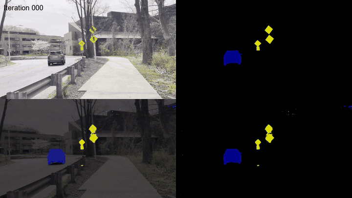

# Transfer Learning in Semantic Segmentation

Self-driving perception models trained on European streets miss what they have never seen, such as American traffic signs. We fine-tuned a Cityscapes-trained DeepLabv3+ on a small street dataset we collected and labeled around Johns Hopkins, lifting pixel accuracy from 66% to 81% and mean IoU from 61% to 78%.

  
   
  Predictions on a validation image improving over the course of fine-tuning.

## Results

| JHUStreet test set | Before fine-tuning | After |
|---|---|---|
| Pixel accuracy | 66.4% | **81.3%** |
| Mean IoU | 61.0% | **78.2%** |
| Traffic sign IoU | 7.2% | **57.5%** |
| Car IoU | 78.5% | 78.8% |

The biggest gain is on traffic signs, which differ most between Europe and the US.

## How it works

- **Data.** Video shot around the Homewood campus on an iPhone, subsampled to frames and hand-labeled into cars, traffic signs and background (46 images, 70/10/20 split).
- **Model.** DeepLabv3+ with a MobileNet backbone, pre-trained on Cityscapes, fine-tuned with random crops, color jitter and flips.
- **Loss.** A custom cross-entropy that also learns from background pixels, which the original Cityscapes setup ignores but a three-class dataset needs.

Details, failure cases and future work are in the [report (PDF)](EN_601_661_Team9-Final_Writeup.pdf).

## Code

Training (`main.py`) and inference (`predict.py`) build on [DeepLabV3Plus-Pytorch](https://github.com/VainF/DeepLabV3Plus-Pytorch) by Gongfan Fang (MIT license); `animation.py` builds the training clip above from per-iteration outputs. Dependencies are in `requirements.txt`.

## Team

Iou-Sheng (Danny) Chang, Ching-Yang (Austin) Huang, Ayush Gupta and Arthur Beyer (Team 9, EN.601.661 Computer Vision, Johns Hopkins University).

More projects: [austinhuang823.github.io](https://austinhuang823.github.io)
